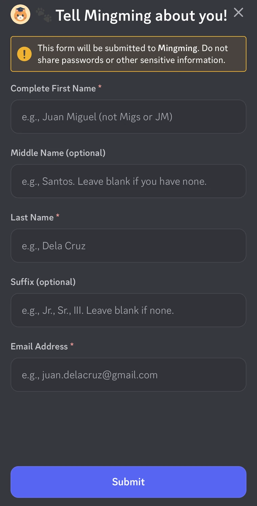
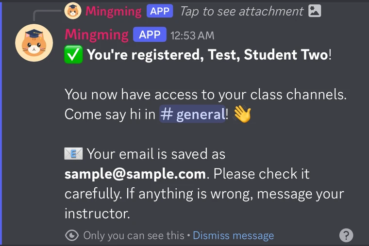
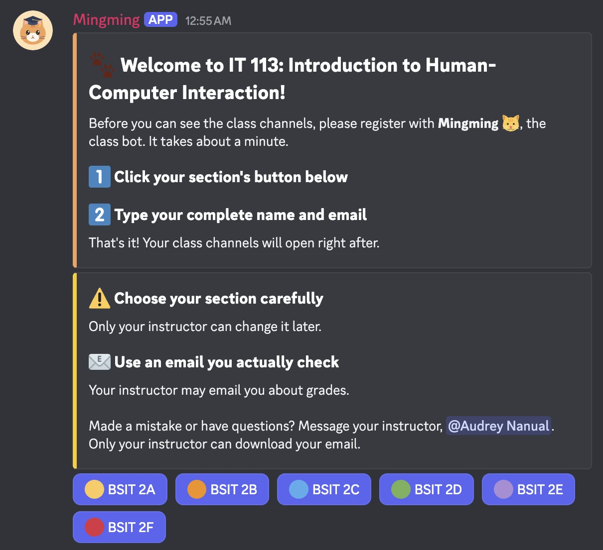
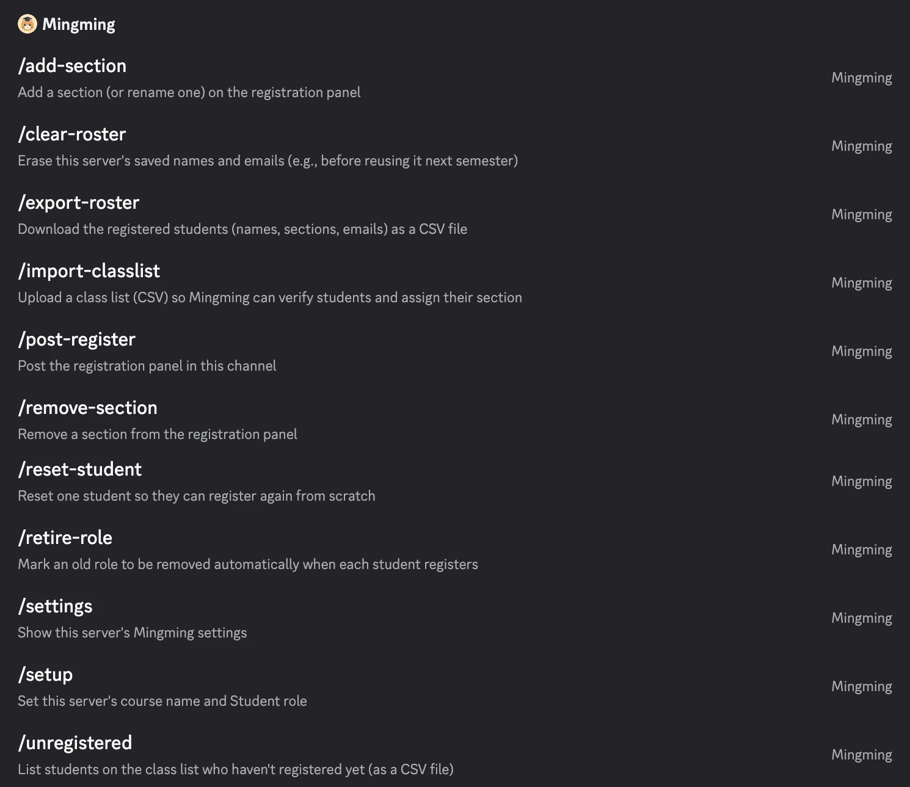

# Mingming 🐱

**A Discord registration bot for class servers.** Students click **Register**, type their complete name and email, and Mingming gives them a proper full-name nickname, puts them in the right section, and unlocks their class channels. It runs on Cloudflare Workers, so there's no server to keep running.

<p>
  
  
</p>



## Why I built it

I'm an IT instructor, and I use Discord as the main way to communicate with my students. With a hundred or more students across several sections, I need to know who is who, but asking everyone to rename themselves to their full name never fully worked: the member list stayed full of nicknames and usernames, and students sometimes picked the wrong section. Mingming makes registration a one-minute form instead of a set of instructions.

## What it does

These are the main features:

- **Uniform nicknames.** Names are formatted in the Philippine records style (*Last, First Suffix M.I.*), shortened smartly to fit Discord's 32-character limit, with the full name kept in the records.
- **Section assignment from the class list.** The instructor uploads the official class list as a CSV. Mingming finds each student on it (tolerating letter case, ñ, small typos, and first and last names typed in the wrong boxes) and assigns the section from the list, so students can't pick the wrong one.
- **Respect for the student's own spelling.** Registrar lists sometimes misspell names. When a student's spelling differs from the list, Mingming keeps the student's version, tells them how to get the record checked, and flags it for the instructor.
- **Instructor alerts.** Registrations that need a second look (not on the list, or spelled differently) ping the instructor in a private channel.
- **Email collection** for contacting students about grades, downloadable only by the instructor.
- **No lockouts.** Existing servers can be moved to Mingming without cutting anyone off from announcements; `/unregistered` lists who still needs a nudge.
- **11 instructor-only slash commands** for setup, sections, class lists, exports, and resets.



## How it works

Mingming uses Discord's **HTTP interactions**: when someone clicks a button, submits the form, or runs a command, Discord sends a request to Mingming's web address on Cloudflare. Cloudflare wakes Mingming up, Mingming does the job (sets the nickname, gives the roles, saves the details), and goes back to sleep. That's why Mingming shows a gray "offline" dot in Discord, but it still works.

**Built with:** JavaScript, Cloudflare Workers, Cloudflare D1 (SQLite), and the Discord Interactions API. No framework and no runtime dependencies; the only dev dependency is Wrangler, Cloudflare's deploy tool.

**Tested with:** 142 automatic checks (`npm test`) that run the real Worker code against an in-memory database and a fake Discord, including Discord permission errors, slow responses, duplicate submissions, and database failures. All names and emails in the tests are made up.

## Privacy

Student data (names, emails, sections) is stored only in the instructor's own Cloudflare D1 database, and only members with the **Manage Server** permission can export it. No student data is included in this repository, and class lists are meant to be kept outside the project folder.

## Status

Mingming runs in three of my class servers: two that were moved from an older bot (see [MIGRATION.md](MIGRATION.md)) and one set up from scratch (see Step 9 below).

## Credits

Built by Audrey Nanual, with help from Claude (Anthropic) for code and documentation.

---

# Setting up your own Mingming

The rest of this README is the full setup guide. It's a one-time setup, about an hour. After this, Mingming runs on Cloudflare for free, with nothing to keep running on your computer.

## What you need

- A computer with **Terminal** (the steps below use macOS; Linux works the same way, and Windows works with small changes)
- **Node.js** version 22.13 or newer: download the LTS version from https://nodejs.org and install it
- A free **Cloudflare** account: https://dash.cloudflare.com/sign-up
- The `mingming-avatar.png` file from this repository (or your own picture)

---

## Step 1: Create Mingming in the Discord Developer Portal

1. Go to https://discord.com/developers/applications → **New Application** → name it **Mingming**.
2. On **General Information**:
   - Upload `mingming-avatar.png` as the **App Icon**.
   - Copy the **Application ID** and **Public Key** into a note. You'll need them soon.
3. On **Installation**: set **Install Link** to **None**.
4. On **Bot**:
   - Upload `mingming-avatar.png` as the icon, and set the username to `Mingming`.
   - Turn **Public Bot** OFF, so only you can add Mingming to servers.
   - Click **Reset Token** and copy the token into your note. **Keep it secret**: anyone with it controls your bot.
   - Leave all "Privileged Gateway Intents" OFF.

## Step 2: Install the project

Open **Terminal**, download the project, and install its one tool (Wrangler):

```bash
git clone https://github.com/audreycj/mingming-bot.git
cd mingming-bot
npm install
```

(Already have the folder? Just `cd` into it and run `npm install`.) Run every command in this guide from inside this folder.

## Step 3: Connect to Cloudflare

```bash
npx wrangler login
```

A browser window opens. Log in to Cloudflare and click **Allow**.

## Step 4: Create the database

```bash
npx wrangler d1 create mingming-db
```

The output includes a line like `database_id = "abc123..."`. Open `wrangler.toml` in any text editor and replace the `database_id` value with yours. (The ID already in the file belongs to the original deployment; it's useless without that Cloudflare account's login, but your copy needs your own.) Then create the tables:

```bash
npm run db:init
```

## Step 5: Deploy Mingming and add its secrets

```bash
npm run deploy
```

The first time, Cloudflare asks you to choose a `workers.dev` subdomain. At the end, it prints Mingming's web address, like `https://mingming.your-name.workers.dev`. Copy it.

Now add the three values from Step 1. Each command asks you to paste the value:

```bash
npx wrangler secret put DISCORD_PUBLIC_KEY
npx wrangler secret put DISCORD_APPLICATION_ID
npx wrangler secret put DISCORD_TOKEN
```

## Step 6: Tell Discord where Mingming lives

1. Back in the Developer Portal → **General Information**.
2. Paste the web address from Step 5 into **Interactions Endpoint URL** → **Save Changes**.

Discord tests the address right away. If it saves without an error, Mingming is connected. 🎉

## Step 7: Register Mingming's commands

```bash
npm run register
```

It asks for your **Application ID** and **bot token**. The token stays hidden while you paste it (you'll see `*` instead), so it isn't saved in your Terminal history. You should see `✅ Registered 11 commands`.

## Step 8: Invite Mingming to your course server

1. Go to https://discord.com/developers/applications → click **Mingming** → **OAuth2** (left sidebar) → **OAuth2 URL Generator**.
2. **Scopes:** check `bot` and `applications.commands`.
3. **Bot Permissions:** check **Manage Roles**, **Manage Nicknames**, **View Channels**, **Send Messages**, and **Embed Links**.
4. Copy the **Generated URL** at the bottom, open it in your browser, choose the course server, and click **Authorize**. Mingming now appears in the server, with its own role named **Mingming**.

You only repeat this step for each new course server.

---

## Step 9: Set up each course server

This step builds a **new** course server from scratch, with `#welcome` as the only channel students see until they register. (Moving an existing server with students already in it? Use **MIGRATION.md** instead.)

**Where it's used:** IT 113 was set up with this step. ITC 120 and IT 110 were moved with MIGRATION.md.

The examples below use a server with six sections, **BSIT 1A** to **BSIT 1F**. For a **one-section server**, follow the notes marked **One section**.

**Names used below:** in **category** settings, Discord uses longer names for two permissions: **Send Messages** appears as **Send Messages and Create Posts**, and **Send Messages in Threads** appears as **Send Messages in Threads and Posts**. They're the same permissions.

### 9.1 Roles

Go to **Server Settings → Roles**. Each role has a **Display** tab (name, color, "Display role members separately," "Allow anyone to @mention this role," and the **View Server As Role** button) and a **Permissions** tab (with a **Clear permissions** link at the top right).

**Always click Clear permissions on every role you create.** New roles start with some permissions already ON (such as Change Nickname), which would let students rename themselves. If any staff-level permission is on, Mingming refuses the role in `/add-section`.

1. **Section roles** (click **Create Role**), one per section, e.g., **BSIT 1A**, **BSIT 1B**, and so on:
   - **Display tab:** give each its own color, turn **Display role members separately ON**, and **Allow anyone to @mention this role OFF**.
   - **Permissions tab:** **Clear permissions**.
   - **Save Changes**.
2. **Student role:** name **Student**, default gray color, Display separately **OFF**, @mention **OFF**, **Clear permissions**, **Save Changes**. Every registered student gets this role on top of their section role.
   - **One section:** skip the section roles. Name this role after the section (e.g., **BSIT 1A**, as in IT 110) so it shows in the member list and on profiles, give it a **color**, and turn **Display separately ON**, since it's the only "registered" group. Wherever this guide says "Student role", it means that role.
3. **Mingming's role:** **Display tab** → **Display role members separately ON** → **Save Changes**. This lists Mingming in its own group right below you in the member list (otherwise it sits under "Online").
4. **Don't use a "Test Account" role.** A test account with no extra roles behaves exactly like a real student.
5. **Role order** (drag roles in the list), top to bottom:
   1. Instructor (if you have one)
   2. **Mingming** (it can only change nicknames and roles of members whose roles are **below** it)
   3. Section roles
   4. Student
   5. @everyone (always last)

### 9.2 Channels and categories

**Layout:**

```
🔒 INSTRUCTOR      bot-commands, join-log
📌 START HERE      welcome
📚 IT 113          announcements, coursework, course-resources
🟦 IT 1A           announcements, general      (same for each section)
```

Use your own course name for the 📚 category. **One section:** no section categories; put `#general` inside the 📚 category instead.

**How to set permissions:** right-click a category → **Edit Category** → **Permissions**. Click **+** next to Roles/Members to add a role. Leave every permission not listed below on **/** (neutral), and click **Save Changes** after each one. For a single channel, hover over it → ⚙️ **Edit Channel** → **Permissions**.

| Category / channel | Permission entries |
|---|---|
| 🔒 **INSTRUCTOR** | **Private Category** ON, no roles added |
| └ #join-log | **Mingming:** View Channel ✅, Send Messages ✅ (Mingming posts here and **@mentions you** when a registration needs your review) |
| 📌 **START HERE** | **@everyone:** View Channel ✅, Read Message History ✅, Send Messages ❌, Send Messages in Threads ❌, Create Public Threads ❌, Create Private Threads ❌ · **Mingming:** View Channel ✅, Send Messages ✅, Embed Links ✅ · *(optional)* **Student:** View Channel ❌ (hides `#welcome` once a student registers) |
| 📚 **Course category** | **@everyone:** Send Messages ❌, Send Messages in Threads ❌, Create Public Threads ❌, Create Private Threads ❌ · **Student:** View Channel ✅ (every registered student can read; only you post) |
| 🟦 **IT 1A** (category) | **Private Category** ON · **@everyone:** Send Messages ❌, Send Messages in Threads ❌, Create Public Threads ❌, Create Private Threads ❌ · **BSIT 1A:** View Channel ✅ |
| └ #announcements | Synced with category (only you post) |
| └ #general | **Custom** (editing it unsyncs it from the category). **BSIT 1A:** View Channel ✅, Send Messages ✅, Send Messages in Threads ✅, Create Public Threads ✅ |

Repeat the section rows for every section with its own role. Keep each section chat named exactly **`general`**, so Mingming can link students to it after they register.

**One section:** in the 📚 category's `#general`, make it **Custom** and add **Student:** Send Messages ✅, Send Messages in Threads ✅, Create Public Threads ✅.

**Then double-check the two channels Mingming posts in**, `#welcome` and `#join-log`: open each one's ⚙️ → **Permissions** and confirm the **Mingming** entry is there with the ✅ above. If a channel says it isn't synced with its category, the category's entries don't reach it, so add them on the channel itself. A missing Mingming entry is what causes "Discord error 403" (Mingming can't post).

**Why private section categories?** The Student role can see the 📚 category, and a section category that only *allows* its own section wouldn't block other sections. Making it private blocks everyone first; then only its section role is let back in.

### 9.3 Server-wide @everyone

Go to **Server Settings → Roles → Default Permissions** (the **@everyone** entry). Do this **after 9.2**, since the category entries from 9.2 are what keep the right channels visible.

**Turn these ON** (normal participation):

- Send Messages and Create Posts, Send Messages in Threads and Posts, Create Public Threads, Read Message History
- Embed Links, Attach Files, Add Reactions, Use External Emoji, Use External Stickers
- Connect, Speak, Video, Use Voice Activity
- Use Application Commands
- Optional: Create Polls, Send Voice Messages, Use Activities

**Turn these OFF:**

- **Staff powers:** Administrator, Manage Channels, Manage Roles, Manage Server, Manage Webhooks, View Audit Log, Manage Nicknames, Manage Messages, Manage Threads and Posts, Manage Expressions, Manage Events
- **Moderation:** Kick, Approve, and Reject Members; Ban Members; Timeout Members; Mute Members; Deafen Members; Move Members
- **Disruptive or unnecessary:** Mention @everyone, @here, and All Roles; Create Invite; Pin Messages; Bypass Slowmode; Send Text-to-Speech Messages; Use Soundboard; Use External Sounds; Priority Speaker; Set Voice Channel Status; Create Private Threads; Create Expressions; Create Events; Use External Apps
- **Change Nickname** (only Mingming sets names)
- **View Channels:** turn this OFF **as the very last click**, then **Save Changes**

**Check it:** Server Settings → Roles → click a section role (e.g., **BSIT 1A**) → **Display** tab → scroll down → **View Server As Role**, and also tick **Student** in the role picker at the top. A registered 1A student should see START HERE, the 📚 category, and IT 1A's `#announcements` and `#general`, but no other section. Exit with the banner at the top of the screen.

### 9.4 Server settings

- **Server Settings → Engagement → System Messages Channel:** `#join-log`. Turn **Prompt members to reply to welcome messages with a sticker** OFF.
- **Default Notification Settings** (on the **Engagement** page, or **Overview** in some Discord versions): **Only @mentions**.

### 9.5 Set up Mingming

Type these in `#bot-commands`:

1. `/setup` → course name (e.g., `IT 113: Introduction to Human-Computer Interaction`), student_role **Student** (or your one-section role), name_format **Last, First**.
2. `/add-section` once per section role, each with an emoji (e.g., **BSIT 1A** 🟦). **One section:** skip this.
3. *(Recommended)* `/import-classlist` → attach your class list CSV. Mingming then finds each student on the list, assigns their section from it, and flags anyone not on it. It reports the number of students per section; check it against your list.

### 9.6 Post the panel and test it

Use a **second Discord account** to test (Discord never lets bots rename the server **owner**, so registering as yourself fails). Its roles must be below Mingming's ([9.1](#91-roles)).

1. In `#welcome`, run `/post-register` → style **Welcome**. If it says "Discord error 403", Mingming's entry on `#welcome` is missing (see [9.2](#92-channels-and-categories)).
2. As the test account, open `#welcome`. You should see the panel with its button(s), and at the bottom "You do not have permission to send messages in this channel". If you see "This is a threads only channel" instead, @everyone still has **Create Public Threads** allowed there.
3. Register with a **made-up name** (e.g., **Juan Tester**). Expect: the nickname changes, the Student (and section) role is added, the class channels appear, and, if you imported a class list, **`#join-log` pings you** because that name isn't on it.
4. Run `/reset-student` on the test account, then `/export-roster` to confirm the test entry is gone.

Done! New students now see only `#welcome` until they register.

---

## Instructor commands

Only members with the **Manage Server** permission can use these, and Mingming's replies are visible only to you.

| Command | What it does |
|---|---|
| `/setup` | Set or change the course name, Student role, and nickname format |
| `/add-section` | Add a section (or rename its button with the optional `label`) |
| `/remove-section` | Remove a section from the panel |
| `/settings` | Show this server's settings and how many students have registered |
| `/post-register` | Post the registration panel in the current channel. Optional **style**: Welcome (new servers, the default) or Re-registration (students already in the server) |
| `/export-roster` | Download names, sections, and emails as a CSV file (opens in Excel or Google Sheets) |
| `/import-classlist` | Upload a class list (CSV). The panel then shows one **Register** button: Mingming finds each student on the list, assigns their section from it, and uses the official spelling of their name. Students not found can pick a section and are flagged "NO - please check" in the export. When a student's spelling differs from the list, their spelling is kept and flagged "Yes, but name differs" |
| `/unregistered` | Download a CSV of everyone on the class list who hasn't registered yet (including students not in the server) |
| `/retire-role` | Mark an old role (e.g., from another bot) to be removed automatically when each student registers |
| `/reset-student` | Pick a student to send back to the start: removes their nickname, class roles, and saved entry, so they can register again from scratch |
| `/clear-roster` | Delete Mingming's saved names and emails for this server (type `DELETE` to confirm). This is data deletion only: students keep their Discord nicknames, roles, and access. |

After adding or removing sections, run `/post-register` again and delete the old panel.

## Common situations

| Situation | What to do |
|---|---|
| A student registered with a wrong name, email, or section | **Recommended:** run `/reset-student` and pick them. They see only `#welcome` again and register from scratch, so Discord and the CSV stay in sync. (Removing their Student role also works; their new answers replace the old ones.) |
| Quick fix by hand | Right-click them → change the nickname or roles yourself. This works instantly in Discord, but the CSV still shows their original answers. |
| Student sees "move my role above..." | Drag Mingming's role above the Student and section roles. |
| "Discord error 403" when posting the panel, or no `#join-log` pings | Mingming has no permission entry on that channel. Add **Mingming** on the channel itself ([9.2](#92-channels-and-categories)). `npx wrangler tail` in Terminal shows these errors live; press **Control + C** to stop it. |
| `#welcome` says "This is a threads only channel" | On `#welcome`, set @everyone's **Create Public Threads** and **Create Private Threads** to ❌ ([9.2](#92-channels-and-categories)). |
| `npm run deploy` says "wrangler: command not found" or "EACCES" | The `node_modules` folder was damaged (usually by copying or syncing the project folder). Delete `node_modules`, then run `npm install` and deploy again. |
| Student sees "panel is out of date" | Run `/post-register` again and delete the old panel. |
| Student sees "I couldn't save your details... click your section's button again" | Rare (a database hiccup). They already have access; clicking again later finishes saving. |
| Student sees "I couldn't save your details... ask your instructor to remove your Student role" | Even rarer (a longer database outage). Run `/reset-student` for them, and they register again. |
| Testing it yourself | Use a second Discord account, and `/reset-student` it between tests. Discord never lets bots rename the server **owner**, so registering as yourself will fail. |

## Starting a new semester

Pick one approach:

**Option A: a fresh server (simplest).** Create a new server for the new class, invite Mingming (Step 8), and set it up (Step 9). The old server can be archived or deleted.

**Option B: reuse the same server.** Do these steps **in this order**:

1. `/export-roster` to keep a copy of last semester's list.
2. `/clear-roster` to delete Mingming's saved names and emails.
3. Run `/remove-section` for **each** old section, so Mingming retires it. Do this **before** deleting the roles in step 4; once a role is deleted, you can no longer pick it in the command, and its old button would stay on the panel.
4. Remove old students' access: in **Server Settings → Roles**, **delete** the Student role and every section role, then create new ones. Deleting a role removes it from everyone at once. Re-apply the new roles' permissions on your channels and categories, and keep Mingming's role above them.
5. Run `/setup` with the new Student role, `/add-section` for each new section role, then `/post-register` (and delete the old panel).
6. Old students who are no longer in your class can be kicked from the server, or simply left with no access.

Returning students simply register again.

## About the student emails

Emails are stored in your Cloudflare database and can only be downloaded through `/export-roster` by people with the **Manage Server** permission (keep that to yourself and any co-instructors). Treat the exported CSV as private student data, and avoid sharing it in public channels or group chats. When a course ends, export what you need and run `/clear-roster`. Note that this deletes Mingming's saved list only, not copies you've already downloaded.

Mingming checks that the email looks like a real address, and after registering, each student sees the email they typed and is asked to check it. It does **not** prove the address belongs to that student. Before sending individual grades, compare the emails against your official class list or school records.

## Checking Mingming yourself (optional)

In the Mingming folder, run:

```bash
npm test
```

This runs 142 automatic checks in about 5 seconds, entirely on your computer. It uses a pretend Discord and a pretend database, so it never touches your real server, your Cloudflare database, or any of your files. Failures like Discord errors, database outages, and slow responses are simulated on purpose. The last line should read `142 passed, 0 failed`.

## Known limits

- **Nicknames are limited to 32 characters by Discord.** Very long names are shortened in Discord, but the full name is kept in the CSV.
- **Staff-role protection is a safety net, not a guarantee.** Mingming refuses roles with major staff powers, but it can't judge channel-by-channel permissions. Keep the Student and section roles plain, and keep Manage Server to yourself.
- **Mingming isn't a full audit system.** It's built for a class registration flow. If you change roles or nicknames by hand, the CSV won't reflect those changes.
